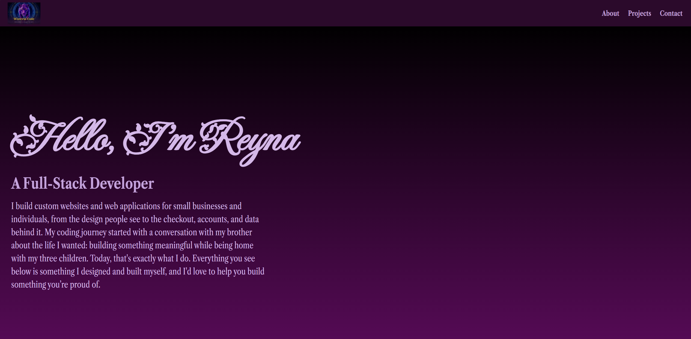

# portfolioWisteriaCode
Work portfolio
# Reyna Ellis – Web Developer Portfolio

My personal portfolio website, showcasing the projects I've built on my journey as a self-taught web developer.

🔗 **Live site:** [reye1195.github.io](https://reye1195.github.io)



---

## About

Hi, I'm Reyna! I'm a web developer with a passion for creating websites. This portfolio brings my work together in one place, from my first freeCodeCamp projects to a custom e-commerce site built for a real small business.

## Built With

- **HTML5** – semantic page structure
- **CSS3** – custom properties, Flexbox, and media queries
- **JavaScript** – vanilla JS, no frameworks
- **Google Fonts** – Fleur De Leah and Titan One
- **Font Awesome** – icons

## Features

- **Fully responsive design** with six breakpoints, from mobile phones up to large desktop screens
- **Project carousel** with arrow buttons that scroll one project at a time and loop from the last project back to the first
- **Fixed navigation bar** that stays visible while scrolling between sections
- **Custom purple color palette** managed with CSS variables for consistent styling
- **Accessible markup**, including alt text on images and labeled scroll buttons

## Featured Projects

| Project | Description |
|---|---|
| **Herbal Harmony with Holistic Healing** | Custom website for a herbal and natural wellness business |
| **Survey Form** | Customer feedback form for a fictional bank, with text inputs, dropdowns, and rating options |
| **Tribute Page** | A biography page with a featured photo and background imagery |
| **Technical Documentation Page** | A CSS reference guide with a fixed sidebar navigation |
| **Product Landing Page** | A product showcase page with navigation and an embedded video |
| **Dynamic Calendar** | A JavaScript calendar that highlights today's date and moves between months |

## Run It Locally

```bash
git clone https://github.com/ReyE1195/ReyE1195.github.io.git
cd ReyE1195.github.io
```

Then open `index.html` in your browser. No installation or build step is needed.

## What I Learned

- Building responsive layouts that work across many screen sizes
- Using CSS variables to keep a color theme consistent and easy to update
- Controlling scroll position with JavaScript to build a custom carousel
- Organizing a multi-section page with clear, maintainable code

## Future Improvements

- Seamless infinite scrolling in the project carousel, removing the visible jump when it loops
- Linking each project tile directly to its own repository and live demo
- Adding touch and swipe support for the carousel on mobile devices

## Contact

- **GitHub:** [ReyE1195](https://github.com/ReyE1195)
- **Email:** [msellis.dev@outlook.com](mailto:msellis.dev@outlook.com)
- **Fiverr:** [Add your Fiverr profile link here]

---

© 2025 Reyna Ellis. All rights reserved.
